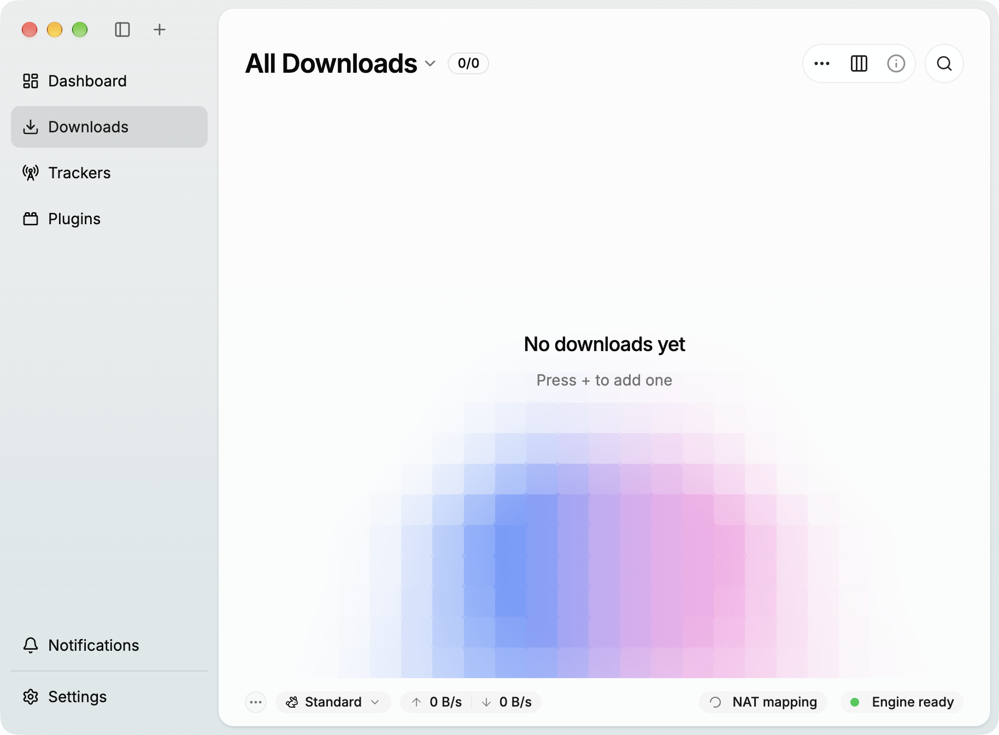
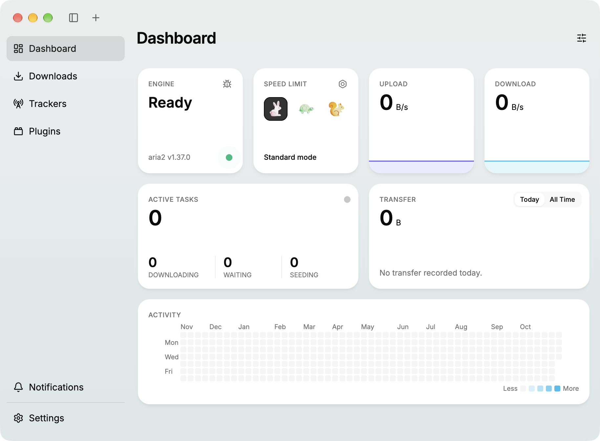

<div align="center">


# Motrix 2.4.2 · macOS 12 Edition

**The original Motrix 2.4.2 experience, patched to launch and run on macOS 12 Monterey.**

[](#requirements)
[](https://github.com/agalwood/Motrix)
[](./LICENSE)
[](https://github.com/a2109246162-tech/motrix-ed2k)

English | [简体中文](./README.zh-CN.md)

</div>

---

## What this edition is

This is a compatibility fork of [agalwood/Motrix](https://github.com/agalwood/Motrix) v2.4.2. Upstream 2.4.2 requires macOS 13; on macOS 12 the app refuses to launch. This edition changes only what is necessary to make the original app run on Monterey.

**It does not add ED2K support.** ED2K links behave exactly as they do in upstream Motrix: they are not recognised and cannot be downloaded. If you need ED2K, use the separate [Motrix ED2K Edition](https://github.com/a2109246162-tech/motrix-ed2k).

| Edition | macOS 12 | ED2K | Best for |
| --- | --- | --- | --- |
| **macOS 12 Edition** (this repo) | ✅ | ❌ | Intel Macs on Monterey that need the original Motrix feature set |
| [ED2K Edition](https://github.com/a2109246162-tech/motrix-ed2k) | ✅ | ✅ | Monterey users who also need ED2K links, sharing and contribution stats |

## Features

Everything from upstream Motrix 2.4.2 is preserved:

- HTTP / HTTPS / FTP downloads with multi-connection acceleration
- BitTorrent and Magnet links
- Task scheduling, speed limits and global speed profiles
- Browser extension integration
- Download history, categories and completion actions
- Light and dark themes, English and Simplified Chinese UI

The only behavioural difference is the minimum supported macOS version.

## Screenshots

<p align="center">
  
</p>

<p align="center">
  
</p>

## Requirements

- macOS 12.0 or later (verified on macOS 12.7.6, Intel x64)
- An Intel Mac; this build is `x64`, not Apple Silicon native
- No ED2K support in this edition

## Install

1. Download the four `.part-*` files from [Releases](../../releases).
2. Join them: `cat Motrix-2.4.2-macos12-x64.dmg.part-* > Motrix-2.4.2-macos12-x64.dmg`.
3. Open the DMG and drag **Motrix** into **Applications**.
3. On first launch, right-click the app and choose **Open** if Gatekeeper blocks it.

The build is ad-hoc signed, not notarized. **Do not enable in-app auto-update** — it would replace the patched binaries and require macOS 13 again.

## What was patched

The full file-by-file record is in [`CHANGELOG-FORK.md`](./CHANGELOG-FORK.md); usage details are in [`README-MACOS12.md`](./README-MACOS12.md).

1. **Bundle metadata** — `LSMinimumSystemVersion` changed from `13.0` to `12.0` in the built `Info.plist`.
2. **Mach-O minimum OS** — `LC_BUILD_VERSION.minos` changed from `13.0` to `12.0` on 18 bundled executables and dylibs via `macos12-patch/patch_minos.py`.
3. **Three macOS 13 symbols** — small forwarding/stub libraries provide:
   - `SMAppService` (ServiceManagement) — login-item registration remains unavailable on macOS 12;
   - `kVTCompressionPropertyKey_ReferenceBufferCount` (VideoToolbox);
   - `NSPreviewRepresentingActivityItem` (AppKit).
4. **Code signatures** — the main app and standalone helpers (`motrix-native-host`, `motrix-finalize-fs`, `MotrixSafariBootstrap`, `MotrixSafariRegistrar`) are ad-hoc re-signed. Skipping this causes `spawn Unknown system error -85` and “task unavailable”.
5. **Quarantine** — removed from the built app so the first launch is not blocked after patching.

Patch sources live in [`macos12-patch/`](./macos12-patch).

## Build from source

```bash
corepack pnpm install --frozen-lockfile
corepack pnpm run build:electron
corepack pnpm exec node scripts/stage-electron-app.mjs --platform darwin --arch x64
```

If you rebuild the app yourself, re-apply the `macos12-patch` steps and re-sign **all** helpers, not just `Motrix.app`.

## Verification

- macOS 12.7.6, Intel Xeon E3-1505M v5: app launches and the dashboard reports the engine ready.
- Bundled aria2 1.37.0 starts and its RPC responds.
- HTTP/HTTPS task creation and download complete normally.
- No new error logs after launch.
- The public repository contains the macOS 12 patch scripts and this document; it contains no ED2K source changes.

## Known limitations

- Login-item registration is unavailable on macOS 12 because `SMAppService` does not exist there.
- The build is ad-hoc signed, not notarized; Gatekeeper may require right-click → Open.
- Auto-update must stay disabled, otherwise the patched binaries are replaced.
- This edition intentionally does not recognise ED2K links.

## Credits and license

- Upstream: [agalwood/Motrix](https://github.com/agalwood/Motrix), MIT.
- Original author: Dr_rOot / agalwood.
- macOS 12 compatibility patches in this fork are released under the same MIT license.

See [`LICENSE`](./LICENSE), [`ATTRIBUTION.md`](./ATTRIBUTION.md) and [`THIRD_PARTY_NOTICES.md`](./THIRD_PARTY_NOTICES.md).
