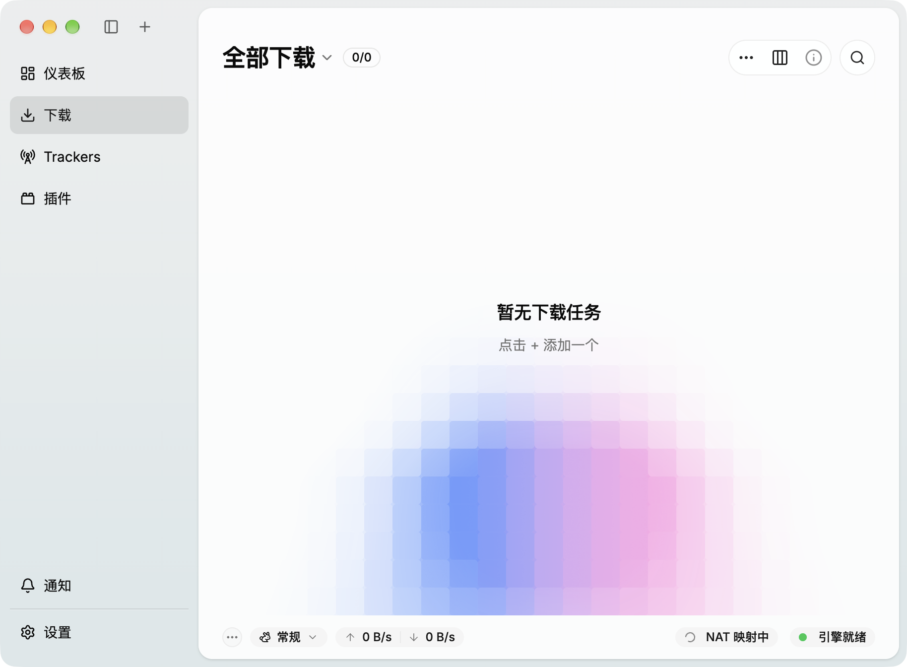
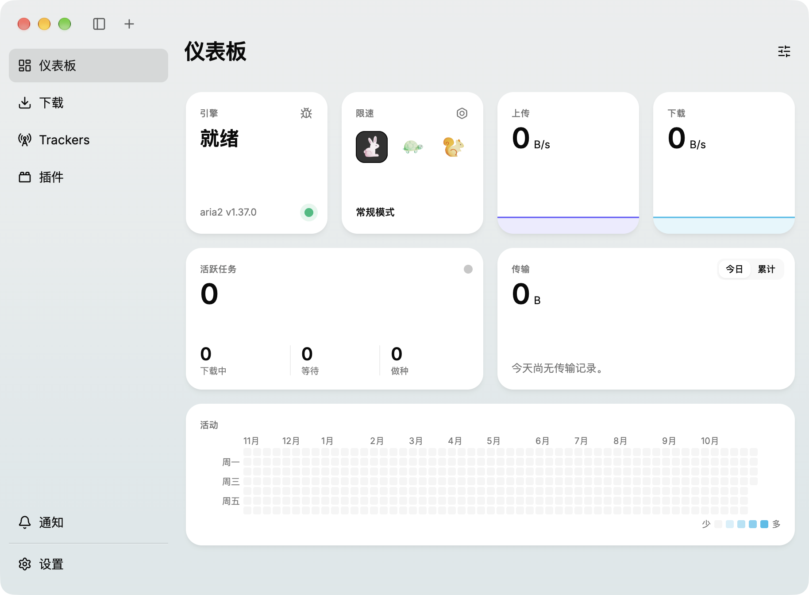

<div align="center">


# Motrix 2.4.2 · macOS 12 兼容版

**保留原版 Motrix 2.4.2 的完整体验，只做 macOS 12 Monterey 兼容修补。**

[](#系统要求)
[](https://github.com/agalwood/Motrix)
[](./LICENSE)
[](https://github.com/a2109246162-tech/motrix-ed2k)

[English](./README.md) | 简体中文

</div>

---

## 这个版本是什么

这是 [agalwood/Motrix](https://github.com/agalwood/Motrix) v2.4.2 的兼容分支。上游 2.4.2 要求 macOS 13，在 macOS 12 上会直接拒绝启动；本版只改让原版能在 Monterey 上运行所必需的部分。

**本版不包含 ED2K 支持。** ED2K 链接的表现和上游 Motrix 完全一致：不识别、不能下载。需要 ED2K 请用另一个 [Motrix ED2K 版](https://github.com/a2109246162-tech/motrix-ed2k)。

| 版本 | macOS 12 | ED2K | 适合谁 |
| --- | --- | --- | --- |
| **macOS 12 兼容版**（本仓库） | ✅ | ❌ | 需要原版 Motrix 功能、系统停在 Monterey 的 Intel Mac |
| [ED2K 版](https://github.com/a2109246162-tech/motrix-ed2k) | ✅ | ✅ | 同时需要 ED2K 链接、分享和贡献统计的 Monterey 用户 |

## 功能

上游 Motrix 2.4.2 的能力全部保留：

- HTTP / HTTPS / FTP 下载，多连接加速
- BitTorrent 与 Magnet 链接
- 任务调度、限速和全局速度配置
- 浏览器扩展接管下载
- 下载历史、分类和完成动作
- 浅色/深色主题，简体中文/英文界面

行为上唯一的区别是最低 macOS 版本。

## 界面

<p align="center">
  
</p>

<p align="center">
  
</p>

## 系统要求

- macOS 12.0 或更高（已在 macOS 12.7.6、Intel x64 实测）
- Intel Mac；本包是 `x64`，不是 Apple Silicon 原生版
- 本版不支持 ED2K

## 安装

1. 从 [Releases](../../releases) 下载四个 `.part-*` 分片。
2. 合并：`cat Motrix-2.4.2-macos12-x64.dmg.part-* > Motrix-2.4.2-macos12-x64.dmg`。
3. 打开 DMG，把 **Motrix** 拖进「应用程序」。
3. 首次启动如被 Gatekeeper 拦截，右键应用选择「打开」。

本构建使用 ad-hoc 签名，未做公证。**不要开启应用内自动更新**，否则会覆盖修补后的二进制，并重新要求 macOS 13。

## 具体改了什么

完整的逐文件记录见 [`CHANGELOG-FORK.md`](./CHANGELOG-FORK.md)，使用说明见 [`README-MACOS12.md`](./README-MACOS12.md)。

1. **包元数据**：构建后的 `Info.plist` 中 `LSMinimumSystemVersion` 从 `13.0` 改为 `12.0`。
2. **Mach-O 最低系统**：18 个可执行文件和动态库的 `LC_BUILD_VERSION.minos` 从 `13.0` 改为 `12.0`，脚本在 `macos12-patch/patch_minos.py`。
3. **三个 macOS 13 符号**：用轻量转发/替身库补齐：
   - `SMAppService`（ServiceManagement）——macOS 12 上登录项注册仍不可用；
   - `kVTCompressionPropertyKey_ReferenceBufferCount`（VideoToolbox）；
   - `NSPreviewRepresentingActivityItem`（AppKit）。
4. **代码签名**：主程序和独立辅助程序（`motrix-native-host`、`motrix-finalize-fs`、`MotrixSafariBootstrap`、`MotrixSafariRegistrar`）全部 ad-hoc 重签。漏签会出现 `spawn Unknown system error -85`，界面提示「任务暂不可用」。
5. **隔离属性**：移除构建产物的 quarantine，避免修补后被系统直接拦截。

补丁源码在 [`macos12-patch/`](./macos12-patch)。

## 从源码构建

```bash
corepack pnpm install --frozen-lockfile
corepack pnpm run build:electron
corepack pnpm exec node scripts/stage-electron-app.mjs --platform darwin --arch x64
```

如果你自己重新打包，必须重新执行 `macos12-patch` 里的步骤，并且重签**所有**辅助程序，不能只签 `Motrix.app`。

## 验证

- macOS 12.7.6、Intel Xeon E3-1505M v5：应用正常启动，仪表盘显示引擎就绪。
- 内置 aria2 1.37.0 启动，RPC 正常响应。
- HTTP/HTTPS 任务可正常创建并完成下载。
- 启动后没有新增错误日志。
- 公开仓库包含 macOS 12 补丁脚本和本文档，不包含任何 ED2K 源码改动。

## 已知限制

- macOS 12 没有 `SMAppService`，登录项注册不可用。
- 构建使用 ad-hoc 签名，未公证；Gatekeeper 可能要求右键 →「打开」。
- 自动更新必须保持关闭，否则修补文件会被覆盖。
- 本版有意不识别 ED2K 链接。

## 致谢与许可证

- 上游：[agalwood/Motrix](https://github.com/agalwood/Motrix)，MIT。
- 原作者：Dr_rOot / agalwood。
- 本分支的 macOS 12 兼容补丁同样以 MIT 许可证发布。

见 [`LICENSE`](./LICENSE)、[`ATTRIBUTION.md`](./ATTRIBUTION.md)、[`THIRD_PARTY_NOTICES.md`](./THIRD_PARTY_NOTICES.md)。
